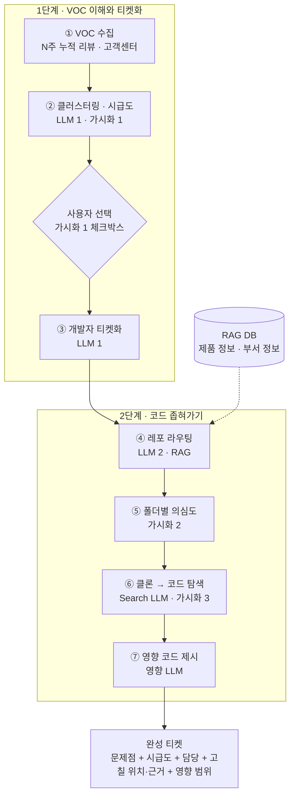

# VOCAI 제품 요구사항 문서 (PRD)

> 고객의 목소리를 담아, 개발자를 도와주는 AI 에이전트

| 항목 | 내용 |
|---|---|
| 프로젝트 | SCSA 27기 AI Agent 프로젝트 |
| 팀 | 임승현, 홍송희 |
| 문서 버전 | v0.1 (기획서 기반 초안) |
| 상태 | 초안, 팀 검토 전 |
| 관련 문서 | `CLAUDE.md` (Claude Code 개발 지침) |

**표기**: **[가정]**이 붙은 항목은 기획서에 정해지지 않아 이 초안에서 임시로 정한 값이다. 팀이 확정하면 표시를 지우고 §18 결정 기록에 남긴다.

---

## 1. 개요

VOCAI는 고객이 쓴 자연어 VOC를 개발자 언어의 티켓으로 바꾸고, 사내 저장소를 레포 → 폴더 → 파일·라인 순서로 좁혀 "어디를 고칠지"를 근거·영향 범위와 함께 보여 주는 AI 에이전트다. 새 코드를 쓰는 AI가 아니라 개발자가 고치게 돕는 AI다.

## 2. 배경과 문제

**VOC는 쌓이는데, 고칠 건 방대하다.**

| 관점 | 문제 |
|---|---|
| 고객 | "갤럭시 워치 업데이트 후 운동하면 손목이 뜨거워요" 같은 VOC가 하루 수십 건씩 쌓인다. |
| 커뮤니케이션 | 고객의 언어(자연어)와 개발자의 언어 사이에 간극이 있다. 고객 언어에는 코드 단어가 없다("뜨겁다" ≠ `samplingPeriodUs`). |
| 개발자 | GitHub의 수십만 줄 코드 앞에서 어디부터 볼지 막막하다. 원인 조사에만 며칠이 걸린다. |

VOC를 코드 위치로 잇는 데는 **번역 · 검색 · 검증**이 모두 필요하다.

## 3. 제품 정의와 원칙

### 3.1 포지셔닝

| 구분 | 입력 | 출력 |
|---|---|---|
| 이미 많이 쓰는 AI | 요구사항(자연어) | 새 코드 생성 |
| **VOCAI (역방향)** | 고객 피드백(자연어 VOC) | 이미 있는 코드의 고칠 곳 |

### 3.2 핵심 가치

VOC를 '티켓화'(개발자 언어화)하고, 어디를 고칠지 가시화한다. 이를 통해 개발 이슈, 일정, 담당자를 명확히 한다.

### 3.3 제품 원칙

| ID | 원칙 | 의미 |
|---|---|---|
| P1 | 고치게 돕고, 고치지 않는다 | 패치·diff·PR을 생성하지 않는다. 결과물은 위치·근거·영향 범위까지다. |
| P2 | 근거와 함께 | 모든 추천에 근거(VOC 건수·발생 조건, 심볼·키워드, 커밋)를 붙인다. |
| P3 | 좁혀 가며 보여 준다 | 전사 레포 → 3개 레포 → 의심 폴더 → 파일·줄 → 영향 범위. 단계마다 결과를 화면에 보여 개발자가 따라가며 확인할 수 있게 한다. |
| P4 | 결정은 사람이 | 티켓 발행 대상과 최종 수정 판단은 개발자가 한다. |
| P5 | 검증된 것만 | 실제 파일에서 확인되지 않은 라인은 보여 주지 않는다. |

## 4. 목표와 성공 지표

### 4.1 목표: 수정 시간 40% 감소

수정 과정을 세 구간으로 나누면 VOCAI가 줄이는 구간은 ①과 ②다.

| 구간 | 내용 | 담당 |
|---|---|---|
| ① VOC 파악·분류 | 클러스터링, 티켓화 | **VOCAI가 줄임** |
| ② 원인 위치 탐색 | 레포 → 폴더 → 라인 | **VOCAI가 줄임** |
| ③ 수정·검증 | 개발자 판단 | 개발자 |

- **논리**: 수정 시간의 절반 이상이 ①·② 조사 단계라는 가정 아래, 이 구간을 자동화해 전체를 절반 가까이로 줄인다. 목표치는 이보다 보수적인 40%로 둔다.
- **근거**: 예제 저장소에서 탐색 범위 약 530줄 → 수정 라인 2줄. 데모에서 사용 전·후 탐색 시간을 직접 측정한다.

### 4.2 성공 지표

| 구분 | 지표 | 정의 | 목표 |
|---|---|---|---|
| 주 지표 | 수정 시간 감소율 | 1 − (사용 시 ①+②+③ 시간 ÷ 미사용 시 ①+②+③ 시간) | ≥ 40% |
| 측정 지표 | 탐색 시간 | VOC 묶음을 받은 뒤 정답 수정 라인을 특정하기까지 걸린 시간(①+②), 사용 전·후 비교 | 데모에서 직접 측정 |
| 보조 지표 | 탐색 범위 | 개발자가 읽어야 하는 줄 수 | 예제 기준 약 530줄 → 2줄 수준 |
| 정확도 [가정] | 레포 Top-3 적중률 | 정답 레포가 후보 3개 안에 있는 비율 | ≥ 90% |
| 정확도 [가정] | 폴더 Top-1 적중률 | 의심도 1위 폴더가 정답인 비율 | ≥ 80% |
| 정확도 [가정] | 라인 적중률 | 추천 범위 중 하나가 정답 수정 라인을 포함하는 비율 | ≥ 70% |
| 신뢰성 | 미검증 라인 노출 | 실제로 없는 라인이 화면에 나온 횟수 | 0 |
| 운영 [가정] | 2단계 처리 시간 | 티켓 1건의 ④~⑦ 소요 시간 | ≤ 3분 |

③은 VOCAI가 직접 줄이지 않는다. 데모에서 ③까지 측정하기 어려우면 ①+② 측정값에 ③ 추정치를 더해 환산하고, 그 방법을 결과에 적는다 [가정].

## 5. 사용자

| 사용자 | 하는 일 | 주로 보는 화면 |
|---|---|---|
| 현업 개발자 (담당 파트) | 티켓을 받아 의심 폴더·라인·영향 범위를 보고 수정 여부를 판단한다. | 가시화 2, 3 |
| 티켓 발행자 (파트 리드, VOC 담당) [가정] | 클러스터 우선순위를 보고 티켓 발행 대상을 골라 담당 파트에 전달한다. | 가시화 1 |

기획서는 "개발자가 취사선택"한다고 했으므로 두 역할을 같은 사람이 맡을 수 있다.

## 6. 범위

### 6.1 포함 (데모 MVP)

- 파일로 넣은 샘플 VOC로 ①~⑦ 전체 파이프라인 실행
- 가시화 1·2·3 Streamlit 화면
- 샘플 저장소 3개(`pulsefit-py`, `pulsefit-sync`, `pulsefit-server`)와 저장소 레지스트리
- RAG DB: 제품 정보, 부서 정보
- 단계별 소요 시간 기록, 사용 전·후 탐색 시간 측정

### 6.2 제외

- 수정 코드·패치·PR 자동 생성 (원칙 P1)
- 분석 대상 코드의 실행·빌드·테스트·재현
- 텔레메트리(에러·트레이스·프로파일) 연동
- 리뷰 플랫폼·고객센터 실시간 수집, Jira 같은 이슈 트래커 자동 등록 [가정: 이후 확장 후보]
- 로그인·권한 관리
- Python 외 언어의 심볼 분석. 다른 언어는 텍스트 검색만 지원한다 [가정]

## 7. 대표 시나리오: VOC-0412 운동 중 발열

1. 사용자가 10/03~10/14 기간의 VOC 파일을 올린다. (①)
2. VOCAI가 VOC를 클러스터로 묶고 우선순위를 매긴다. (②, 가시화 1)

   | 우선순위 | 클러스터 | 카테고리 · 제품 | 건수 | 추세 |
   |---|---|---|---|---|
   | 긴급 | 운동 중 기기 발열 | 센서 · 워치 앱 | 91 | ▲ 8.8배 |
   | 높음 | 배터리 급소모 | 전력 · 워치 앱 | 58 | ▲ 1.6배 |
   | 높음 | 연결 끊김 시 발열 | 동기화 · 워치 앱 | 24 | ▲ 신규 |
   | 보통 | 화면 사용성 | UI · 워치 앱 | 29 | – 보합 |
   | 낮음 | GPS 거리 오차 | 위치 · 워치 앱 | 17 | – 보합 |

3. 사용자가 상위 3개를 체크하고 티켓을 발행한다. VOCAI가 고객 언어를 개발자 언어로 바꿔 티켓을 만든다. (③)

   ```
   티켓 VOC-0412                                          [긴급]
   일시       10/03 ~ 10/14
   제품       워치 헬스 앱
   문제점     운동 중 센서 과다 동작 (발열)
   시급도     91건 · 8.8배 급증
   담당       센서 파트
   수정 위치  (2단계에서 채움)
   ```

4. 레포 라우팅: `pulsefit-py`(워치 앱) 0.82, `pulsefit-sync`(폰 연동) 0.41, `pulsefit-server`(서버) 0.12. (④, 가시화 2)
5. 폴더별 의심도(`pulsefit-py`): `sensor/` 0.86, `workout/` 0.52, `sync/` 0.38, `ui/` 0.21, `power/` 0.10, `storage/` 0.05. `ui/`는 '발열' 키워드가 많지만 표시 전용이라 감점된다. (⑤, 가시화 2)
6. 최신 배포 코드를 clone하고 수정 라인을 찾는다. (⑥, 가시화 3)

   ```python
   # sensor/heart_rate.py
   15  # 운동 중 연속 측정
   17  POLL_INTERVAL_S = 0.05
   45  while self._running.is_set():
   47      self.filter.push(...)
   52      time.sleep(POLL_INTERVAL_S)
   ```

   - 추천: L17, L45–52 수정
   - 근거: 발열 VOC 91건, 운동 중 발생, 10/02 커밋에서 측정 주기 1.0 → 0.05초로 변경
7. 영향 범위: `workout/session.py`가 `start_continuous()`를 호출하므로 수정 시 함께 확인해야 한다. (⑦, 가시화 3)
8. 티켓의 수정 위치·근거·영향 범위가 채워지고, 개발자는 ③ 수정·검증으로 넘어간다.

## 8. 시스템 구성

### 8.1 전체 흐름



### 8.2 단계별 범위 축소

| 단계 | 입력 | 출력 | 범위 |
|---|---|---|---|
| ④ 레포 라우팅 | 티켓, RAG 문서, 레지스트리 | 레포 후보 ≤ 3개와 점수 | 전사 레포 → 3개 |
| ⑤ 폴더별 의심도 | 후보 레포의 인덱스 | 폴더별 의심도와 사유 | 3개 레포 → 의심 폴더 |
| ⑥ 클론 → 코드 탐색 | 의심 상위 폴더, clone 결과 | 파일·라인 추천과 근거 | 폴더 → 파일·줄 |
| ⑦ 영향 코드 제시 | 추천 라인의 심볼 | 영향받는 호출부·모듈·레포 | → 영향 범위 |

### 8.3 LangGraph 구성

LLM 단계는 LangGraph로 구성한다.

- **그래프 A `stage1_graph`**: `ingest → cluster → prioritize → END`. 결과를 가시화 1에 보여 준다.
- **사용자 선택 게이트**: 가시화 1에서 체크한 `cluster_id` 목록만 다음으로 넘긴다. Streamlit의 재실행 모델과 맞추기 쉽도록 이 게이트는 그래프 밖에 둔다. 이후 LangGraph `interrupt`로 옮길 수 있다 [가정].
- **그래프 B `ticketize`**: 선택된 클러스터마다 ③을 실행한다.
- **그래프 C `stage2_graph`** (티켓 1건 단위): `route_repos → score_folders → clone_repos → search_lines → verify_lines → analyze_impact → finalize_ticket → END`
  - `verify_lines`에서 실패한 추천이 있으면 `search_lines`로 한 번 되돌아간다. 두 번째 실패분은 버린다.
  - 레포 최고 점수가 임계값(0.3 [가정]) 미만이면 티켓에 "라우팅 신뢰도 낮음"을 표시하고 계속 진행한다.

State 주요 필드:

| 필드 | 내용 |
|---|---|
| `vocs` | 마스킹된 VOC 목록 |
| `clusters` | 클러스터와 우선순위 |
| `selected_cluster_ids` | 사용자가 체크한 클러스터 |
| `tickets`, `current_ticket` | 발행된 티켓, 2단계에서 처리 중인 티켓 |
| `repo_candidates` | 레포 후보 ≤ 3개 |
| `folder_scores` | 레포별 폴더 의심도 |
| `clones` | 레포별 clone 경로와 커밋 sha |
| `line_recommendations` | 수정 라인 추천 (검증 여부 포함) |
| `impacts` | 영향 범위 |
| `timings` | 노드별 소요 시간 |
| `errors` | 노드별 오류·경고 |

### 8.4 RAG

- **대상 DB**: 제품 정보(제품, 기능, 관련 레포·폴더, 사내 용어), 부서 정보(파트, 담당 영역, 담당 레포)
- **원문**: `data/rag/products/*.md`, `data/rag/departments/*.md`
- **구축**: 청크 분할 → 임베딩 → Chroma 로컬 저장 [가정]
- **질의**: 티켓의 제품, 문제점, 기술 키워드

### 8.5 저장소 레지스트리

라우팅과 clone 대상은 레지스트리에 등록된 저장소로 한정한다.

```yaml
# data/repos.yaml
repos:
  - name: pulsefit-py
    url: https://github.com/<org>/pulsefit-py.git   # 로컬 데모는 file:// 경로 허용
    product: 워치 헬스 앱
    description: 워치 앱 (센서 측정, 운동 세션, 화면, 전력, 저장)
    owner_parts: [센서 파트, 전력 파트, UI 파트]
    deploy_ref: main          # "최신 배포 코드" 기준 브랜치 또는 태그
    folder_roles:             # 선택. ⑤ 역할 보정에 사용
      ui/: display_only
  - name: pulsefit-sync
    url: https://github.com/<org>/pulsefit-sync.git
    product: 워치 헬스 앱
    description: 폰 연동 (블루투스 동기화)
    owner_parts: [동기화 파트]
    deploy_ref: main
  - name: pulsefit-server
    url: https://github.com/<org>/pulsefit-server.git
    product: 워치 헬스 앱
    description: 서버 (기록 저장, 통계 API)
    owner_parts: [서버 파트]
    deploy_ref: main
```

## 9. 기능 요구사항

### FR-1 VOC 수집 (①)

- **입력**: N주 누적 리뷰·고객센터 VOC 파일(CSV 또는 JSON) [가정]. 필드는 `voc_id`, `created_at`, `channel`(review / call_center), `text`가 필수이고 `product`, `app_version`, `rating`은 선택이다.
- **처리**: 스키마 검증, 중복 제거, 분석 기간 필터, 개인정보 마스킹(전화번호, 이메일, 주문번호 등).
- **출력**: `VOC` 목록, 거부된 행 목록과 사유.
- **수용 기준**
  - 필수 필드가 빠진 행은 거부 목록에 사유와 함께 남는다.
  - 마스킹 전 원문은 LLM에 전달되지 않는다.

### FR-2 클러스터링 (②)

- **처리** [가정]: VOC 임베딩 → HDBSCAN 클러스터링 → LLM 1이 클러스터마다 라벨, 카테고리, 제품을 붙이고, 같은 문제로 보이는 클러스터를 합치거나 섞인 클러스터를 나눈다.
- **출력**: 클러스터별 라벨(예: "운동 중 기기 발열"), 카테고리(센서 / 전력 / 동기화 / UI / 위치 등), 제품, 소속 VOC id, 대표 VOC 3~5개, 일별 건수.
- **수용 기준**
  - 모든 VOC는 정확히 한 클러스터(또는 "기타")에 속한다.
  - 라벨은 고객이 겪는 증상을 짧게 요약한다.
  - 샘플 데이터에서 §7의 클러스터 5개가 나온다.

### FR-3 시급도 산정 (②)

- **급증률** [가정]: 분석 기간 건수 ÷ 직전 같은 길이 기간 건수. 직전 기간이 0건이면 "신규".
- **추세 표시** [가정]: 급증률 ≥ 1.3이면 ▲, ≤ 0.7이면 ▼, 그 사이는 보합. 신규는 "▲ 신규".
- **심각도** [가정]: LLM 1이 1~5로 판정한다. 기준은 신체 위해·안전(발열, 화상) 5, 기능 불가 4, 성능 저하(배터리 등) 3, 기능 부정확·사용성 2, 단순 불만 1.
- **우선순위 점수** [가정]: `0.3 × 건수 정규화 + 0.3 × 급증 정규화 + 0.4 × (심각도 ÷ 5)`
  - 건수 정규화 = 건수 ÷ 기간 내 최대 건수
  - 급증 정규화 = min(log2(급증률) ÷ 3, 1), 급증률 ≤ 1이면 0, 신규는 1
- **라벨** [가정]: 점수 ≥ 0.8 긴급, ≥ 0.45 높음, ≥ 0.25 보통, 그 아래는 낮음.
- **수용 기준**: 샘플 데이터에서 §7 표의 우선순위 라벨이 그대로 나온다. 가중치와 임계값은 `config.py`에서 바꿀 수 있다.

### FR-4 티켓 발행 대상 선택 (가시화 1)

- 사용자가 체크한 클러스터만 티켓으로 발행하고 담당 파트에 전달한다.
- 체크하지 않은 클러스터는 다음 분석 때까지 대시보드에만 남는다.

### FR-5 개발자 티켓화 (③)

- **입력**: 선택된 클러스터, 대표 VOC, 부서 정보.
- **처리**: LLM 1이 고객 언어를 개발자 언어로 옮긴다.
- **출력 (티켓 필드)**
  - `ticket_id` (예: VOC-0412), 기간, 제품, 우선순위
  - 문제점: 기술 용어로 쓴 한 줄 (예: "운동 중 센서 과다 동작 (발열)")
  - 시급도: 건수, 급증률
  - 발생 조건: VOC에서 뽑은 조건 (예: 운동 중, 업데이트 후)
  - 기술 키워드: 2단계 검색에 쓸 코드 쪽 용어 (예: 센서 샘플링 주기, 폴링 간격, 연속 측정)
  - 담당 파트: 부서 정보 기준
  - 근거 VOC id
  - 수정 위치, 영향 범위: 비워 두고 2단계에서 채운다
- **수용 기준**
  - 문제점과 기술 키워드는 고객 표현을 그대로 옮기지 않고 코드 쪽 용어로 쓴다.
  - 담당 파트는 부서 정보에 있는 파트 중 하나다.

### FR-6 레포 라우팅 (④)

- **입력**: 티켓, RAG 검색 결과(제품 정보·부서 정보), 저장소 레지스트리.
- **처리**: LLM 2가 레지스트리의 저장소마다 0~1 관련도와 이유를 매긴다.
- **출력**: 점수 내림차순 후보 최대 3개. 점수 0.1 미만은 제외한다 [가정].
- **수용 기준**
  - 후보는 3개 이하이고 모두 레지스트리에 있는 저장소다.
  - 후보마다 이유가 한 줄 이상 있다.

### FR-7 레포 인덱스 (⑤)

- **처리**: 후보 레포마다 폴더 단위 인덱스를 만든다 [가정].
  - 파일 목록, 모듈 docstring·README 요약
  - 심볼(함수, 클래스, 상수) 목록
  - 폴더 역할: 레지스트리의 `folder_roles`를 우선 쓰고, 없으면 import 관계와 요약으로 추정한다
  - 분석 기간 시작일 이전 30일의 폴더별 커밋 이력
- **수용 기준**: 같은 커밋 sha에 대해서는 인덱스를 다시 만들지 않고 캐시를 쓴다.

### FR-8 폴더별 의심도 (⑤)

- **점수** [가정]: `(0.4 × 의미 유사도 + 0.3 × 키워드·심볼 매칭 + 0.3 × 최근 변경) × 역할 보정`
  - 의미 유사도: 티켓(문제점 + 기술 키워드)과 폴더 요약의 임베딩 유사도
  - 키워드·심볼 매칭: 기술 키워드와 폴더 심볼의 매칭
  - 최근 변경: VOC 시작일 직전에 바뀐 커밋이 있을수록 높다
  - 역할 보정: 문제의 성격과 폴더 역할이 맞지 않으면 감점한다 (예: 센서 동작 문제인데 표시 전용 폴더면 × 0.5)
- **출력**: 레포별 폴더 의심도(0~1), 신호별 값, 가점·감점 사유 한 줄.
- **수용 기준**
  - 샘플 데이터에서 `pulsefit-py`의 `sensor/`가 1위다.
  - `ui/`는 '발열' 키워드가 많아도 역할 보정으로 상위권에 오르지 않고, 감점 사유가 표시된다.

### FR-9 클론 (⑥)

- 레지스트리의 `deploy_ref`(최신 배포 기준)로 clone한다.
- 커밋 근거를 찾을 수 있도록 VOC 시작일 이전 30일 이상의 이력을 받는다(`--shallow-since` 등) [가정].
- 경로는 `workspace/<repo>@<sha>/`. 같은 sha가 있으면 다시 받지 않는다.
- **수용 기준**: clone한 커밋 sha가 화면에 표시된다. 대상 코드를 실행하지 않는다.

### FR-10 수정 라인 탐색 (⑥ Search LLM)

- **후보 파일 선정** (LLM 없이) [가정]: 의심도 상위 폴더 2개 안에서 다음 신호로 파일 5개를 고른다.
  - 기술 키워드·심볼 매칭
  - VOC 시작일 직전 커밋에서 바뀐 파일
  - 파일 요약 임베딩 유사도
- **컨텍스트**: 후보 파일 내용에 라인 번호를 붙여 넘기고, 관련 커밋 diff 요약을 함께 넣는다. 토큰 상한을 넘으면 관련도 낮은 구간부터 줄인다.
- **Search LLM 출력**: 파일 경로, 라인 범위(여러 개 가능), 해당 범위의 스니펫, 추천 이유, 근거, confidence(0~1).
- **수용 기준**: 샘플 데이터에서 `sensor/heart_rate.py`의 L17과 L45–52가 추천된다.

### FR-11 라인 검증과 커밋 근거 (⑥)

- 파일이 clone된 sha에 실제로 있는지, 라인 범위가 파일 길이 안에 있는지, LLM이 인용한 스니펫이 해당 범위 텍스트와 일치하는지(공백 정규화 후) 확인한다.
- 추천 라인에 `git blame`을 돌려 마지막으로 바꾼 커밋을 찾는다. 그 커밋이 VOC 시작일 직전이면 커밋 sha, 날짜, 변경 내용(예: 1.0 → 0.05)을 근거에 추가한다. 커밋 근거는 LLM 주장이 아니라 git 결과에서만 만든다.
- **수용 기준**
  - 검증에 실패한 추천은 화면에 나오지 않는다.
  - 샘플 데이터에서 10/02 커밋이 근거로 붙는다.

### FR-12 영향 코드 제시 (⑦ 영향 LLM)

- **심볼 추출**: 추천 라인에서 정의되거나 쓰이는 상수·함수, 그 코드를 감싼 메서드와 그 메서드를 시작하는 공개 메서드(예: `POLL_INTERVAL_S`, 측정 루프, `start_continuous()`).
- **참조 탐색**: 같은 레포는 `ast`로 호출·참조를 찾고, 다른 후보 레포는 심볼명·설정 키 텍스트 검색으로 찾는다.
- **영향 LLM**: 참조마다 왜 영향을 받는지 한 줄로 설명하고 중요도 순으로 정렬한다.
- **출력**: 레포, 파일, 라인, 심볼, 관계(예: "`start_continuous()` 호출"), 설명.
- **수용 기준**: 샘플 데이터에서 `workout/session.py`의 `start_continuous()` 호출이 나온다.

### FR-13 티켓 완성과 내보내기

- 티켓에 수정 위치·근거·영향 범위를 채운다.
- 완성 티켓을 Markdown과 JSON으로 내보낸다 [가정].

### FR-14 측정 기록

- 노드별 소요 시간을 `timings`에 남기고 화면에 표시한다.
- 데모 측정용으로 과제 시작·종료 시각, 정답 여부를 기록하는 간단한 폼을 둔다 [가정].

## 10. 화면 요구사항 (Streamlit)

웹 화면은 Streamlit으로 구현한다. 세 개의 화면으로 **무엇을 · 어디를 · 어느 줄을** 보여 준다.

### UI-0 공통

- 사이드바: 현재 티켓, 단계 진행 상태(①~⑦), 단계별 소요 시간
- 오류·경고는 해당 단계 옆에 표시한다 (예: "라우팅 신뢰도 낮음")

### UI-1 가시화 1: 티켓 대시보드

목적: VOC 클러스터와 우선순위를 보고 개발자가 취사선택한다.

- 분석 기간 선택, VOC 파일 업로드, "분석" 버튼
- 클러스터 표: 체크박스 | 우선순위 배지(긴급 / 높음 / 보통 / 낮음) | 라벨 | 카테고리 · 제품 | 건수 | 추세(▲ x배 / ▲ 신규 / – 보합). `st.data_editor`의 체크박스 열 사용 [가정]
- 클러스터 건수 추세 차트(일별)
- 클러스터를 고르면 대표 VOC 원문(마스킹된 것)을 보여 준다
- 안내 문구 "체크한 클러스터만 티켓 발행 · 담당 파트로 전달"과 발행 버튼
- 발행 후 티켓 카드 목록 (§7의 VOC-0412 형식)

### UI-2 가시화 2: 레포 지도 · 폴더별 의심도

목적: VOC가 가리키는 곳을 보여 준다.

- 티켓 선택
- 레포 라우팅 결과(최대 3개): 레포명 · 설명 · 점수 막대 · 이유
- 레포를 고르면 폴더별 의심도 가로 막대를 점수 순으로 표시
- 가점·감점 사유 주석 (예: "ui/는 '발열' 키워드가 많지만 표시 전용 → 감점")
- 선택: 폴더 트리맵 [가정]

### UI-3 가시화 3: 코드 가시화 · 수정 라인 추천

목적: 근거와 영향 범위를 함께 보여 준다.

- 추천 파일 목록, clone 커밋 sha, 파일 경로
- 코드 뷰: 라인 번호, 추천 라인 하이라이트, 추천 범위 앞뒤 일부 줄. Pygments `HtmlFormatter(linenos=..., hl_lines=...)` 결과를 `st.html`로 출력 [가정]
- 요약 문구 (예: "L17 · L45–52 수정 추천")
- 근거 박스: VOC 건수, 발생 조건, 커밋 sha·날짜·변경 내용
- 참고(영향) 박스: 함께 확인할 호출부·모듈·레포

## 11. 데이터 모델

`src/vocai/schemas.py`의 기준 모델이다 [가정: 필드명은 구현 중 조정].

```python
from datetime import date, datetime
from typing import Literal
from pydantic import BaseModel

Priority = Literal["긴급", "높음", "보통", "낮음"]

class VOC(BaseModel):
    voc_id: str
    created_at: datetime
    channel: Literal["review", "call_center"]
    text: str                          # 마스킹된 본문
    product: str | None = None
    app_version: str | None = None

class Cluster(BaseModel):
    cluster_id: str
    label: str                         # "운동 중 기기 발열"
    category: str                      # "센서"
    product: str                       # "워치 앱"
    voc_ids: list[str]
    sample_voc_ids: list[str]
    count: int
    surge_ratio: float | None          # None이면 신규
    trend: Literal["up", "flat", "down", "new"]
    severity: int                      # 1~5
    priority_score: float              # 0~1
    priority: Priority
    daily_counts: dict[date, int]

class Evidence(BaseModel):
    kind: Literal["voc", "commit", "symbol", "keyword"]
    detail: str                        # "10/02 커밋에서 측정 주기 1.0 → 0.05초"
    ref: str | None = None             # 커밋 sha, voc_id 등

class LineRecommendation(BaseModel):
    repo: str
    commit_sha: str
    path: str                          # "sensor/heart_rate.py"
    ranges: list[tuple[int, int]]      # [(17, 17), (45, 52)]
    snippet: str
    reason: str
    evidence: list[Evidence]
    confidence: float                  # 0~1
    verified: bool = False

class ImpactItem(BaseModel):
    repo: str
    path: str
    line: int | None
    symbol: str                        # "start_continuous"
    relation: str                      # "start_continuous() 호출"
    explanation: str

class Ticket(BaseModel):
    ticket_id: str                     # "VOC-0412"
    cluster_id: str
    period: tuple[date, date]
    product: str
    problem: str                       # 개발자 언어 문제점
    conditions: list[str]              # ["운동 중", "업데이트 후"]
    tech_keywords: list[str]
    count: int
    surge_ratio: float | None
    priority: Priority
    owner_part: str                    # "센서 파트"
    voc_ids: list[str]
    fix_locations: list[LineRecommendation] = []
    impacts: list[ImpactItem] = []
    warnings: list[str] = []

class RepoCandidate(BaseModel):
    name: str
    score: float                       # 0~1
    reason: str

class FolderScore(BaseModel):
    repo: str
    path: str                          # "sensor/"
    score: float                       # 0~1
    signals: dict[str, float]          # {"semantic": .., "keyword": .., "recent": .., "role": ..}
    note: str | None = None            # 가점·감점 사유
```

## 12. 비기능 요구사항

| 구분 | 요구사항 |
|---|---|
| 신뢰성 | 검증되지 않은 라인은 노출하지 않는다. 레지스트리 밖 저장소는 다루지 않는다. 모든 추천에 근거가 있다. |
| 보안 | 대상 저장소는 읽기 전용이다(실행·수정·push 금지). 비밀값은 `.env`에만 둔다. VOC 개인정보는 LLM 전송 전에 마스킹한다. |
| 프롬프트 주입 대비 | 대상 저장소의 주석·문자열·README와 VOC 본문은 데이터로만 다루고, 그 안의 지시를 따르지 않는다. |
| 성능 [가정] | 1단계는 VOC 1,000건 기준 5분 이내, 2단계는 티켓 1건 기준 3분 이내. |
| 비용 | 파일 전체 대신 후보 구간만 LLM에 보낸다. 같은 sha의 인덱스·임베딩은 캐시한다. |
| 관측성 | 노드별 소요 시간, LLM 호출별 프롬프트 버전·토큰 수를 기록한다. |
| 재현성 | 데모는 고정 샘플 데이터와 고정 커밋으로 실행한다. 점수의 순위는 실행마다 같아야 한다. |

## 13. 데모와 평가 계획

### 13.1 샘플 VOC

분석 기간 10/03~10/14(12일)와 직전 기간 9/21~10/02의 합성 VOC를 만든다 [가정].

| 클러스터 | 분석 기간 | 직전 기간 | 급증률 |
|---|---|---|---|
| 운동 중 기기 발열 | 91 | 약 10 | 8.8배 |
| 배터리 급소모 | 58 | 약 36 | 1.6배 |
| 연결 끊김 시 발열 | 24 | 0 | 신규 |
| 화면 사용성 | 29 | 약 29 | 보합 |
| GPS 거리 오차 | 17 | 약 17 | 보합 |

표현은 고객 말투로 다양하게 만들고, 코드 용어는 넣지 않는다.

### 13.2 샘플 저장소

`scripts/build_sample_repos.py`가 `pulsefit-py`, `pulsefit-sync`, `pulsefit-server`를 만든다. 커밋 날짜를 지정해(`GIT_AUTHOR_DATE`, `GIT_COMMITTER_DATE`) 원인 커밋을 VOC 시작 직전에 둔다 [가정].

| 클러스터 | 심을 원인 [가정] | 원인 커밋 |
|---|---|---|
| 운동 중 기기 발열 | `pulsefit-py/sensor/heart_rate.py` 측정 주기 1.0 → 0.05초 | 10/02 |
| 배터리 급소모 | `pulsefit-py/power/` 쪽 원인 | 10/02 이전 |
| 연결 끊김 시 발열 | `pulsefit-py/sync/` 또는 `pulsefit-sync`의 재연결 재시도 루프 | 10/02 이전 |
| GPS 거리 오차 | `pulsefit-py/workout/` 거리 계산 | 직전 기간 이전 (보합 유지) |

`pulsefit-py/ui/`에는 '발열' 경고 문구처럼 키워드는 많지만 원인과 무관한 표시 코드를 둬서 역할 보정을 확인한다.

### 13.3 정답 케이스

```yaml
# eval/cases.yaml
- case_id: heat-during-workout
  cluster_label: 운동 중 기기 발열
  expected:
    owner_part: 센서 파트
    repo: pulsefit-py
    folder: sensor/
    file: sensor/heart_rate.py
    lines: [[17, 17], [45, 52]]
    commit_date: "10-02"
    impacts: [workout/session.py]
```

### 13.4 측정 절차 [가정]

1. 과제: "이 VOC 묶음의 원인 라인을 찾아라"를 케이스별로 준다.
2. 조건 A(미사용): VOC 원문과 저장소만 준다. IDE 검색은 허용한다.
3. 조건 B(사용): VOCAI 화면과 저장소를 준다.
4. 같은 케이스를 같은 사람이 두 번 풀면 학습 효과가 생기므로, 참가자마다 케이스를 바꿔 A/B를 교차 배정한다.
5. 기록: 시작부터 정답 라인을 특정할 때까지의 시간, 정답 여부, 열어 본 파일 수.

### 13.5 결과 보고

케이스별 시간, 평균 감소율, §4.2 정확도 지표를 함께 보고한다. ③을 환산했다면 그 방법을 적는다.

## 14. 기존 도구와의 차이

| 도구 | 입력 | 결과물 | 우리 관점의 한계 |
|---|---|---|---|
| Atlassian Rovo Dev | 개발자가 쓴 Jira 작업 항목 | 코드 생성 → PR | 고객 언어를 해석하지 않는다. Jira와 Bitbucket/GitHub 연결이 필요하다. AI 코드 리스크가 있다. |
| Sentry Seer (Autofix) | 계측 데이터(에러, 트레이스, 프로파일) | 원인 분석 + 수정 PR | 텔레메트리에 잡힌 이슈가 출발점이다. 개발자가 쓴 티켓부터 입력할 수 있고, 자연어 VOC는 불가하다. |
| Datadog Bits AI Dev Agent | 관측 데이터(에러, 회귀, 보안) | 수정 PR | 위와 같다. 계측이 없는 '체감' 문제는 대상 밖이다. |
| **VOCAI** | 고객이 쓴 자연어 VOC | 티켓 + 레포 지도 + 수정 파일·영향 | 고쳐 주는 AI가 아니라 개발자의 수정을 돕는 AI 에이전트 |

- **기존 도구의 특징**: 결과물이 PR(코드 diff)과 텍스트다. 코드베이스 지도 위에 "이 피드백 때문에 여기가 의심스럽다"를 보여 주는 가시화는 없다.
- **식별자·재현 조건이 없는 VOC**: "발열이 심해" 같은 피드백에서 얼마나 잘 되는지 공개된 근거가 거의 없다.
- **VOCAI의 차별점**: 티켓화(개발자 언어화)와 가시화. 출발점이 고객의 말이고, 결과가 "어디를 볼지"다.

## 15. 업무 분장

| 담당 | 역할 | 코드 범위 |
|---|---|---|
| 임승현 | 기획, 코드 검토, VOC 클러스터링(1단계) | `stage1/` (①②③), 1단계 프롬프트 |
| 홍송희 | 기획 디벨롭, 웹 가시화, 메인 코드 개발(Search LLM, 영향 LLM) | `app/`, `stage2/code_search.py`, `verify.py`, `impact.py` (⑥⑦) |
| 미정 | 레포 라우팅·RAG(④), 폴더 의심도(⑤), 샘플 데이터·저장소, 평가 | `stage2/rag.py`, `repo_router.py`, `repo_index.py`, `folder_score.py`, `scripts/`, `eval/` |

## 16. 마일스톤 [가정: 날짜 미정]

| 단계 | 내용 | 완료 기준 |
|---|---|---|
| M0 기반 | 저장소 구조, `schemas.py`, `llm/client.py`, 샘플 VOC·RAG 문서, 샘플 저장소 생성 스크립트 | 샘플 데이터와 샘플 저장소가 만들어진다 |
| M1 1단계 | ①②③, UI-1 | 대시보드에서 §7 표가 나오고 티켓이 발행된다 |
| M2 레포·폴더 | ④⑤, UI-2 | VOC-0412에서 `pulsefit-py`, `sensor/`가 1위로 나온다 |
| M3 라인·영향 | ⑥⑦, UI-3 | L17, L45–52와 `workout/session.py`가 근거와 함께 나온다 |
| M4 통합·평가 | 그래프 연결, 회귀 테스트, 측정, 발표 자료 | §4.2 지표 측정 결과가 나온다 |

## 17. 리스크와 오픈 이슈

### 17.1 리스크

| 리스크 | 영향 | 대응 |
|---|---|---|
| "①·②가 수정 시간의 절반 이상"이라는 가정이 틀릴 수 있다 | 40% 목표의 근거가 약해진다 | 데모에서 ①·②·③ 비중을 함께 측정해 보고한다 |
| LLM이 없는 라인이나 파일을 추천한다 | 신뢰 하락 | FR-11 검증, 실패분 미노출 |
| 고객 단어가 코드 단어와 다르다 ("뜨겁다" ≠ `samplingPeriodUs`) | 검색 실패 | ③에서 기술 키워드를 만들고, 의미 유사도와 커밋 이력을 함께 쓴다 |
| 키워드가 많은 무관 폴더가 상위에 오른다 (`ui/`) | 잘못된 안내 | 폴더 역할 보정과 사유 표시 |
| 큰 저장소가 LLM 컨텍스트를 넘는다 | 비용·정확도 저하 | 단계별 범위 축소, 후보 구간만 전달 |
| 합성 데이터가 실제 VOC를 대표하지 못한다 | 데모 결과 과대평가 | 한계를 결과 보고에 명시하고, 가능하면 공개 앱 리뷰로 추가 검증한다 |
| 식별자·재현 조건이 없는 VOC 성능에 대한 공개 근거가 거의 없다 | 비교 기준 부족 | 자체 정답 케이스(§13.3)로 평가한다 |

### 17.2 오픈 이슈

| ID | 질문 | 현재 초안 |
|---|---|---|
| O-1 | LLM 제공자와 모델 | `.env`로 교체 가능하게 두고 미정 |
| O-2 | 벡터 스토어 | Chroma 로컬 |
| O-3 | 클러스터링 방식 | 임베딩 + HDBSCAN + LLM 라벨링 |
| O-4 | 담당 파트를 ③에서 정할지 ④에서 정할지 | ③에서 부서 정보로 정하고 ④에서 보정 |
| O-5 | ⑤에서 LLM을 쓸지 (기획서에는 LLM 표기 없음) | 점수 계산은 LLM 없이, 폴더 역할 추정에만 선택적으로 사용 |
| O-6 | "최신 배포 코드"의 기준 (브랜치 / 릴리스 태그) | 레지스트리 `deploy_ref` |
| O-7 | 티켓 ID 체계 | `VOC-` + 4자리 일련번호 |
| O-8 | 티켓 전달 방식 (Jira 등 연동 여부) | 데모에서는 화면과 Markdown·JSON 내보내기만 |
| O-9 | ④⑤ 담당자 | 미정 |

## 18. 결정 기록

| 날짜 | 결정 | 출처 |
|---|---|---|
| 기획서 | LLM 단계는 LangGraph로 구성한다 | 기획서 2쪽 |
| 기획서 | 웹 화면은 Streamlit으로 구현한다 | 기획서 3쪽 |
| 기획서 | 레포 라우팅 후보는 최대 3개 | 기획서 2쪽 |
| 기획서 | RAG 대상 DB는 제품 정보·부서 정보 | 기획서 2쪽 |
| 기획서 | 코드를 고치거나 PR을 만들지 않는다 | 기획서 1·4쪽 |
| | (이후 결정을 여기에 추가) | |
